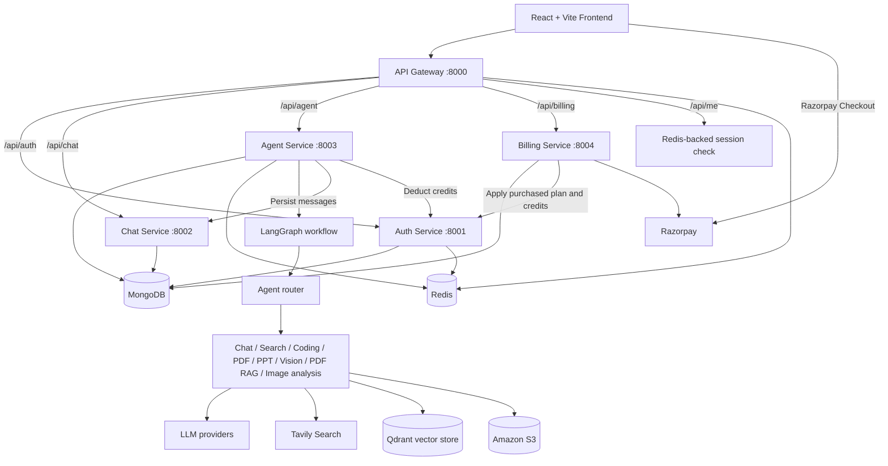

# CortexAI

CortexAI is a full-stack, multi-agent AI assistant that brings conversational AI, coding assistance, web search, document understanding, content generation, and credit-based billing into one workspace.

The application uses a React frontend and a Node.js/Express backend split into independently deployable services. A LangGraph workflow routes requests to specialised agent flows, while MongoDB stores users, conversations, messages, and payments. Redis is used for sessions, cached conversation context, and per-agent rate limits. Generated files are stored in Amazon S3 and delivered through temporary signed URLs.

## Contents

- [Features](#features)
- [Technology stack](#technology-stack)
- [Architecture](#architecture)
- [Agent workflows](#agent-workflows)
- [Data storage](#data-storage)
- [Plans, credits, and rate limits](#plans-credits-and-rate-limits)
- [Project structure](#project-structure)
- [Getting started](#getting-started)
- [Environment variables](#environment-variables)
- [API overview](#api-overview)
- [Docker and deployment](#docker-and-deployment)
- [Implementation notes and production hardening](#implementation-notes-and-production-hardening)

## Features

### AI assistant and conversations

- Chat with an AI assistant using natural-language prompts.
- Automatically route prompts to an agent, or select an agent manually.
- Persist conversations and messages in MongoDB.
- Cache recent conversation context in Redis for subsequent model calls.
- Render assistant responses as Markdown, including formatted code blocks, tables, and links.

### Specialist AI capabilities

| Capability | What it does |
|---|---|
| Chat | Handles general questions, explanations, and conversational requests. |
| Web search | Retrieves up to five web results through Tavily and passes the results to the chat agent to compose an answer. Search results can also include images. |
| Coding | Classifies coding requests (generation, review, explanation, debugging, optimisation, conversion, or documentation). Generation requests return project files as structured data. |
| PDF generation | Creates a structured document from a prompt and generates a downloadable PDF. |
| PDF question-answering | Extracts text from an uploaded PDF, splits it into chunks, retrieves relevant chunks through Qdrant similarity search, and answers using the retrieved document context. |
| PPT generation | Creates a presentation containing a cover slide, six content slides, and a closing slide. |
| Image analysis | Accepts an uploaded image and answers questions about its visible content. |
| Image generation | Converts a text request into an image prompt, requests an image from the configured image-generation endpoint, and stores the resulting image in S3. |

### Code artifacts

- Display generated files in a Monaco Editor panel.
- Switch between files returned by the coding agent.
- Copy the selected file's contents.
- Preview generated HTML with its accompanying CSS and JavaScript when an `index.html` file is present.
- Show the artifact panel as a side panel on larger screens and as a mobile drawer on smaller screens.

The current preview combines `index.html`, `style.css`, and `script.js`; it is not a general-purpose runtime for arbitrary generated project structures.

### Authentication and billing

- Google sign-in through Firebase Authentication.
- Firebase Admin token verification on the backend.
- HTTP-only session cookies backed by Redis.
- Starter and Pro paid plans through Razorpay Checkout.
- Credit balances displayed in the application.
- Generated PDF, PPT, and image files stored in Amazon S3 and served using signed download URLs.

### User experience

- Responsive conversation sidebar and chat layout.
- Agent selection from the chat composer.
- PDF and image uploads.
- Browser speech recognition where supported.
- Loading and generation states, image viewing, and code-copy controls.

## Technology stack

| Layer | Technologies |
|---|---|
| Frontend | React, Vite, Redux Toolkit, Axios, Tailwind CSS utility classes, Motion, Lucide React |
| Authentication | Firebase Authentication, Firebase Admin SDK |
| Backend | Node.js, Express.js, MongoDB, Mongoose |
| API routing | Express HTTP Proxy |
| AI orchestration | LangChain, LangGraph |
| Language models | Groq (`openai/gpt-oss-120b`), OpenRouter (`deepseek/deepseek-chat`), Google Gemini (`gemini-2.5-flash`) |
| Search | Tavily |
| Embeddings | Google Generative AI embeddings (`gemini-embedding-001`) |
| Vector database | Qdrant |
| Cache and sessions | Redis, ioredis |
| Payments | Razorpay |
| File storage | Amazon S3, AWS SDK for JavaScript, S3 presigned URLs |
| File generation and parsing | PDFKit, PptxGenJS, `pdf-parse` |
| Image generation endpoint | Pollinations image endpoint |
| Containers and deployment | Docker, Docker Compose (Redis service), Amazon ECR, Amazon ECS, Amazon S3, Amazon CloudFront, GitHub Actions |

## Architecture

CortexAI is organised as a small set of independently running backend services. The frontend communicates with the API Gateway; the gateway forwards requests to the appropriate service. The Agent service runs the LangGraph workflow and calls the model providers and supporting integrations needed by each agent.



### Service responsibilities

| Service | Local port | Responsibility |
|---|---:|---|
| API Gateway | `8000` | Applies session protection to protected routes, proxies requests to backend services, and exposes the current-user endpoint. |
| Auth | `8001` | Verifies Firebase ID tokens, creates users, manages Redis-backed sessions, updates plans, and deducts credits. |
| Chat | `8002` | Creates and lists conversations, updates conversation titles, and stores and retrieves messages. |
| Agent | `8003` | Accepts chat requests and optional files, invokes the LangGraph workflow, calls specialist agents, and coordinates message persistence. |
| Billing | `8004` | Creates Razorpay orders, stores payment records, verifies payment signatures, and asks the Auth service to apply purchased credits and plans. |

The backend services have individual Dockerfiles. The supplied `Backend/docker-compose.yml` currently defines **Redis only**; it does not start the API Gateway or the application services.

## Agent workflows

### Automatic routing

When the frontend sends a request with the `Auto` agent selected, the LangGraph router chooses a workflow:

1. If a file is attached, a PDF is routed to the PDF RAG workflow and an image is routed to the image-analysis workflow.
2. If no file is attached, the router asks a language model to classify the prompt as chat, search, coding, PDF generation, PPT generation, or image generation.
3. The graph executes the selected agent.
4. A search request runs the search agent and then passes its results to the chat agent to formulate the response.

Selecting a specific agent in the frontend bypasses automatic routing. For example, selecting **PDF** requests PDF generation; leaving **Auto** selected and attaching a PDF invokes PDF question-answering.

### Agent details

| Agent | Processing flow | Output |
|---|---|---|
| Chat | Loads cached or persisted conversation history, builds a prompt, and invokes the chat model. | Markdown or plain-text response. |
| Search | Calls Tavily with the user's query and requests up to five results. The graph then sends the results to Chat. | Search-grounded response and available image results. |
| Coding | Classifies the coding intent. For code generation, requests JSON containing file names and contents; for other intents, requests a Markdown response. | Explanation or generated file artifacts. |
| PDF | Requests structured document data, then uses PDFKit to create a PDF. | Temporary S3 download link. |
| PDF RAG | Parses the uploaded PDF, splits text into chunks of 1,000 characters with 200-character overlap, embeds the chunks, and retrieves the five most relevant chunks from Qdrant. | Answer based on retrieved PDF context. |
| PPT | Requests presentation content and uses PptxGenJS to create the PowerPoint file. | Temporary S3 download link. |
| Image analysis | Reads the uploaded image and sends it with the user's question to the image-analysis model. | Image-grounded response. |
| Vision / image generation | Uses a language model to expand the request into an image prompt, then requests the image from the Pollinations image endpoint. | Generated image and temporary S3 link. |

### Upload constraints

The supplied Multer configuration accepts:

- PDF files (`application/pdf`)
- Image files (`image/*`)
- Maximum upload size: **20 MB**

The frontend sends uploads as `multipart/form-data` to `POST /api/agent/chat`.

## Data storage

### MongoDB

The Mongoose models in the supplied code cover the following records:

- **User:** Firebase UID, name, email, avatar, plan, current credits, total credits, and plan expiry.
- **Conversation:** owner user ID, title, and timestamps.
- **Message:** conversation ID, role, content, optional image URLs, optional code artifacts, and timestamps.
- **Payment:** user ID, Razorpay order and payment IDs, amount, currency, plan, credits, and payment status.

The Auth, Chat, Billing, and Agent service configurations establish Mongoose connections using `MONGODB_URI`. Configure the URI for the database environment you intend those services to use.

### Redis

Redis is used for:

- Session data keyed by `session-<sessionId>`.
- A user-to-session lookup keyed by `user-session-<userId>`.
- Cached conversation context keyed by `messages-<conversationId>`.
- Per-user, per-agent rate-limit counters.

The session cookie is configured as HTTP-only, secure, and `SameSite=None`, with a seven-day lifetime. `getMemory` initially seeds the conversation cache with a 24-hour expiry; subsequent cache updates do not reapply that expiry, so the effective cache lifetime should be reviewed.

### Qdrant

For PDF question-answering, the Agent service creates a Qdrant collection for the uploaded document and performs similarity search over its embedded text chunks. The collection name is generated per upload.

### Amazon S3

Generated PDFs, PowerPoint files, and images are uploaded to the configured S3 bucket. The application returns presigned `GetObject` URLs for downloads rather than making the bucket objects public.

## Plans, credits, and rate limits

### Plans defined in the backend

| Plan | Price | Credits granted | Validity configured |
|---|---:|---:|---:|
| Free | ₹0 | 100 | 30 days |
| Starter | ₹199 | 500 | 30 days |
| Pro | ₹499 | 1,000 | 30 days |

The frontend billing drawer currently presents the Starter and Pro upgrade options. The Free plan is the default user plan in the user model.

### Credit cost by capability

| Capability | Credits per request |
|---|---:|
| Chat | 1 |
| Search | 5 |
| Coding | 10 |
| PDF generation / PDF RAG | 10 |
| PPT generation | 10 |
| Image analysis / image generation | 10 |

### Per-minute agent limits

| Agent category | Requests per minute |
|---|---:|
| Chat | 20 |
| Coding | 5 |
| PDF | 5 |
| PPT | 5 |
| Image | 5 |
| Search | 5 |

These values are defined in `Backend/services/agent/config/agentLimit.js` and enforced using Redis counters.

## Project structure

```text
CortexAI/
├── Backend/
│   ├── gateway/                 # API Gateway and session middleware
│   ├── services/
│   │   ├── agent/                # LangGraph, specialist agents, AI integrations
│   │   ├── auth/                 # Firebase verification, users, sessions, credits
│   │   ├── billing/              # Razorpay orders and payment verification
│   │   └── chat/                 # Conversations and messages
│   ├── shared/
│   │   └── redis/                # Shared Redis client
│   ├── docker-compose.yml        # Currently starts Redis only
│   └── package.json
└── Frontend/
    ├── public/
    ├── src/
    │   ├── assets/
    │   ├── components/           # Chat, sidebar, billing, artifact UI
    │   ├── features/             # API request functions
    │   ├── pages/                # Main application page
    │   ├── store/                 # Redux Toolkit slices and store
    │   ├── App.jsx
    │   └── main.jsx
    ├── utils/                    # Axios and Firebase setup
    └── package.json
```

## Getting started

### Prerequisites

Install or provision the following before starting the application:

- Node.js and npm
- Docker and Docker Compose (for the supplied local Redis container)
- A MongoDB instance
- A Redis instance
- Firebase project credentials for Google sign-in and Firebase Admin verification
- API credentials for the model providers and Tavily used by the Agent service
- A Qdrant instance for PDF RAG
- An AWS S3 bucket and credentials for generated-file storage
- Razorpay credentials for payment flows

Not every integration is needed to start the frontend or test every route. The relevant credentials are required when the corresponding feature is used.

### 1. Start Redis

From the `Backend` directory:

```bash
cd Backend
docker compose up -d
```

This starts the Redis container defined in `docker-compose.yml` and exposes it on port `6379`.

### 2. Configure backend environment variables

Create the service-specific `.env` files described in [Environment variables](#environment-variables). Run each service from its own directory so `dotenv` can load that service's `.env` file.

The Auth service also imports a Firebase Admin service-account JSON file from `Backend/services/auth/serviceAccountKey.json`. Keep this credential out of source control. For production, prefer injecting it through your deployment secret-management mechanism and adjust the credential-loading code accordingly.

### 3. Install backend dependencies

Install the shared Backend dependencies and the dependencies for each service:

```bash
cd Backend
npm install

cd gateway
npm install

cd ../services/auth
npm install

cd ../chat
npm install

cd ../agent
npm install

cd ../billing
npm install
```

### 4. Run the backend services

Start each service in a separate terminal. The following commands use the `dev` scripts defined in the supplied service package files:

```bash
# Terminal 1 — API Gateway
cd Backend/gateway
npm run dev

# Terminal 2 — Auth Service
cd Backend/services/auth
npm run dev

# Terminal 3 — Chat Service
cd Backend/services/chat
npm run dev

# Terminal 4 — Agent Service
cd Backend/services/agent
npm run dev

# Terminal 5 — Billing Service
cd Backend/services/billing
npm run dev
```

The default ports in the Dockerfiles are `8000`–`8004` respectively. Set each service's `PORT` environment variable to the corresponding port for local development.

### 5. Configure and run the frontend

Create `Frontend/.env` with the frontend variables in the [Environment variables](#environment-variables) section. Then run:

```bash
cd Frontend
npm install
npm run dev
```

With the standard Vite development configuration, the frontend is usually served at `http://localhost:5173`. Ensure the Gateway's `FRONTEND_URL` matches the actual frontend origin.

### 6. Build the frontend

```bash
cd Frontend
npm install
npm run build
```

Vite writes the production build to `Frontend/dist`, which is the directory uploaded to S3 by the supplied GitHub Actions workflow.

## Environment variables

The source code reads the following environment variables. Add only the variables required by each service to that service's environment. Use real values in local `.env` files or deployment secrets; do not commit credentials.

### API Gateway — `Backend/gateway/.env`

```env
PORT=8000
FRONTEND_URL=http://localhost:5173
AUTH_SERVICE=http://localhost:8001
CHAT_SERVICE=http://localhost:8002
BILLING_SERVICE=http://localhost:8004
AGENT_SERVICE=http://localhost:8003
```

### Auth service — `Backend/services/auth/.env`

```env
PORT=8001
MONGODB_URI=<your-mongodb-connection-string>
REDIS_URL=redis://localhost:6379
```

The current Firebase Admin implementation loads `serviceAccountKey.json` from the Auth service directory.

### Chat service — `Backend/services/chat/.env`

```env
PORT=8002
MONGODB_URI=<your-mongodb-connection-string>
```

### Agent service — `Backend/services/agent/.env`

```env
PORT=8003
MONGODB_URI=<your-mongodb-connection-string>
REDIS_URL=redis://localhost:6379

# Internal service URLs
CHAT_SERVICE=http://localhost:8002
AUTH_SERVICE=http://localhost:8001

# Model and search providers
GROQ_API_KEY=<your-groq-api-key>
OPENROUTER_API_KEY=<your-openrouter-api-key>
GOOGLE_API_KEY=<your-google-ai-api-key>
TAVILY_API_KEY=<your-tavily-api-key>
QDRANT_URL=<your-qdrant-url>

# Amazon S3
AWS_REGION=<your-aws-region>
AWS_ACCESS_KEY_ID=<your-aws-access-key-id>
AWS_SECRET_KEY=<your-aws-secret-access-key>
AWS_BUCKET_NAME=<your-s3-bucket-name>
```

### Billing service — `Backend/services/billing/.env`

```env
PORT=8004
MONGODB_URI=<your-mongodb-connection-string>
AUTH_SERVICE=http://localhost:8001
RAZORPAY_KEY_ID=<your-razorpay-key-id>
RAZORPAY_KEY_SECRET=<your-razorpay-key-secret>
```

### Frontend — `Frontend/.env`

```env
VITE_SERVER_URL=http://localhost:8000
VITE_FIREBASE_API_KEY=<your-firebase-web-api-key>
VITE_RAZORPAY_KEY_ID=<your-razorpay-key-id>
```

The Firebase client configuration also contains project-specific identifiers in `Frontend/utils/firebase.js`. Replace those values with the configuration for your own Firebase project if deploying a separate instance.

> **Important:** The environment variable names above follow the supplied source code. In particular, the Agent service's S3 client reads `AWS_ACCESS_KEY_ID` and `AWS_SECRET_KEY`, while the GitHub Actions workflow uses separate repository secrets named `AWS_ACCESS_KEY` and `AWS_SECRET_ACCESS_KEY` to configure the deployment runner. Do not assume those names are interchangeable without checking the relevant code or workflow.

## API overview

All frontend API requests are sent to the API Gateway. The Gateway proxies the route prefixes below to their respective backend services.

### Authentication and current user

| Method | Endpoint | Purpose |
|---|---|---|
| `POST` | `/api/auth/login` | Verifies a Firebase ID token and creates or retrieves the user session. |
| `GET` | `/api/auth/logout` | Removes the current Redis session and clears the session cookie. |
| `GET` | `/api/me` | Returns the user attached to the current protected session. |

Login request body:

```json
{
  "token": "<firebase-id-token>"
}
```

### Conversations and messages

| Method | Endpoint | Purpose |
|---|---|---|
| `GET` | `/api/chat/create-conversation` | Creates a conversation for the authenticated user. |
| `GET` | `/api/chat/get-conversations` | Lists the authenticated user's conversations, newest first. |
| `POST` | `/api/chat/update-conversation` | Updates a conversation title. |
| `GET` | `/api/chat/get-messages/:conversationId` | Retrieves messages for a conversation. |

Update conversation request body:

```json
{
  "id": "<conversation-id>",
  "title": "<new-title>"
}
```

The Chat service also exposes `POST /save-message` for message persistence. The Agent service calls this endpoint internally when saving the user's prompt and the assistant's response.

### Agent request

| Method | Endpoint | Content type | Purpose |
|---|---|---|---|
| `POST` | `/api/agent/chat` | `multipart/form-data` | Runs an agent workflow, optionally with an uploaded PDF or image. |

Form fields:

| Field | Required | Description |
|---|---|---|
| `prompt` | Yes for normal requests | User's message or instruction. |
| `conversationId` | Yes | Conversation to which the message belongs. |
| `agent` | Yes | `auto`, `chat`, `search`, `coding`, `pdf`, `ppt`, or `vision`. |
| `file` | No | One supported PDF or image file, up to 20 MB. |

Example response shape:

```json
{
  "answer": "<assistant-response>",
  "images": [],
  "artifacts": []
}
```

The `artifacts` array is populated for code-generation responses. The `images` array can contain images returned by search.

### Billing

| Method | Endpoint | Purpose |
|---|---|---|
| `POST` | `/api/billing/create` | Creates a Razorpay order for a selected plan. |
| `POST` | `/api/billing/verify` | Verifies the Razorpay payment signature and applies the purchased plan and credits. |

Create-order request body:

```json
{
  "plan": "starter"
}
```

Supported paid plan IDs are `starter` and `pro`.

Payment verification request body:

```json
{
  "razorpay_order_id": "<razorpay-order-id>",
  "razorpay_payment_id": "<razorpay-payment-id>",
  "razorpay_signature": "<razorpay-signature>"
}
```

The Auth service also defines `/update-plan` and `/deduct-credits` endpoints, which are used by the Billing and Agent services for internal operations. They should be restricted to trusted service-to-service calls before public production use.

## Docker and deployment

### Docker images

The backend contains a Dockerfile for each service. The supplied GitHub Actions workflow builds them using `Backend` as the Docker build context:

```bash
docker build -f Backend/gateway/Dockerfile -t gateway Backend
docker build -f Backend/services/auth/Dockerfile -t auth-service Backend
docker build -f Backend/services/chat/Dockerfile -t chat-service Backend
docker build -f Backend/services/agent/Dockerfile -t agent-service Backend
docker build -f Backend/services/billing/Dockerfile -t billing-service Backend
```

The Dockerfiles expose the following container ports:

- Gateway: `8000`
- Auth: `8001`
- Chat: `8002`
- Agent: `8003`
- Billing: `8004`

### GitHub Actions deployment flow

The provided deployment workflow runs on pushes to `main` and contains two jobs:

1. **Deploy backend**
   - Checks out the repository.
   - Configures AWS credentials.
   - Authenticates to Amazon ECR.
   - Builds and pushes the Gateway, Auth, Chat, Agent, and Billing images.
   - Forces a new deployment for each corresponding ECS service.
2. **Deploy frontend**
   - Runs after the backend deployment job.
   - Installs frontend dependencies and builds the Vite application.
   - Syncs `Frontend/dist` to the configured S3 bucket using `aws s3 sync --delete`.
   - Creates a CloudFront invalidation for `/*`.

The workflow expects the following GitHub Actions repository secrets:

| Secret | Purpose |
|---|---|
| `AWS_REGION` | AWS region used for ECR, ECS, S3, and CloudFront. |
| `AWS_ACCOUNT_ID` | AWS account ID used to form ECR image URIs. |
| `AWS_ACCESS_KEY` | Access key used by the workflow's AWS credentials action. |
| `AWS_SECRET_ACCESS_KEY` | Secret key used by the workflow's AWS credentials action. |
| `ECS_CLUSTER` | ECS cluster containing the application services. |
| `GATEWAY_SERVICE` | ECS Gateway service name. |
| `AUTH_SERVICE` | ECS Auth service name. |
| `CHAT_SERVICE` | ECS Chat service name. |
| `AGENT_SERVICE` | ECS Agent service name. |
| `BILLING_SERVICE` | ECS Billing service name. |
| `S3_BUCKET` | Frontend hosting bucket. |
| `CLOUDFRONT_DISTRIBUTION_ID` | CloudFront distribution to invalidate after upload. |

Create the ECR repositories referenced by the workflow (`gateway`, `auth-service`, `chat-service`, `agent-service`, and `billing-service`) before running the pipeline. Configure the ECS task definitions, networking, service discovery or internal service URLs, runtime environment variables, and secrets separately in AWS; the workflow shown builds and pushes images and forces ECS deployments, but does not create that infrastructure.

